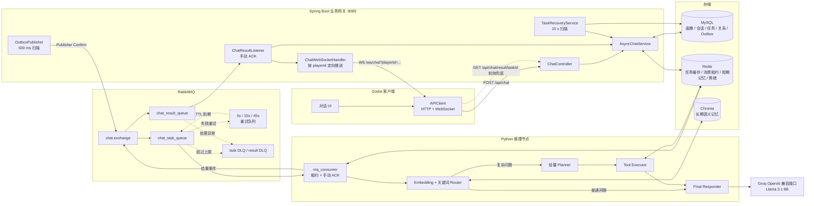
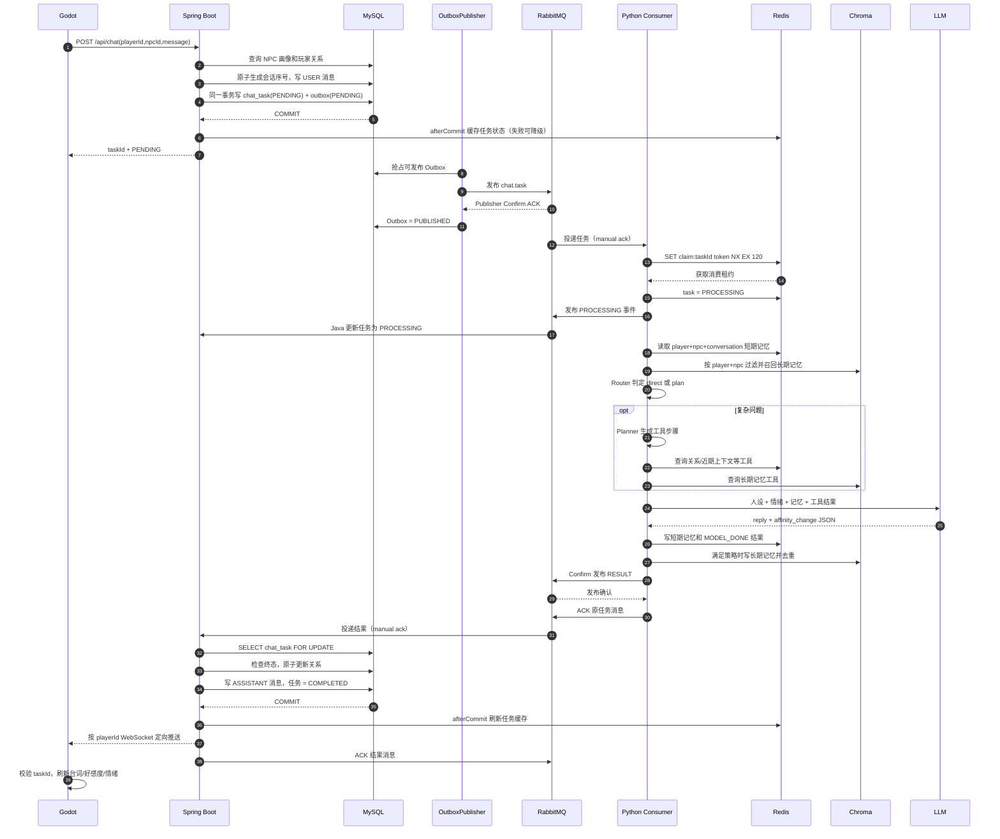
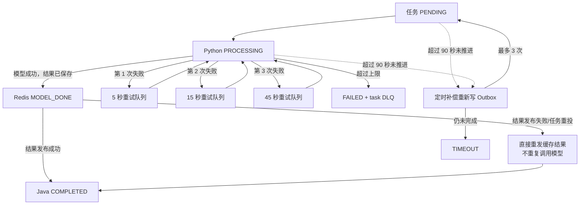

# 赛博小镇：面试项目讲稿与架构说明

> 这份讲稿严格按照当前仓库代码整理。背诵时记住叙事主线，不要逐字硬背：**实时交互为什么异步化 → 异步链路如何保证可靠 → NPC 如何获得人设、关系和分层记忆。**

## 一、30 秒项目介绍

我独立做了一个大模型驱动的多 NPC 实时交互系统。客户端用 Godot，Spring Boot 作为业务网关，负责 NPC 画像、会话、玩家关系和异步任务；Python 服务负责 LangChain Agent 和模型推理。因为大模型响应时间不稳定，我没有让游戏请求同步等待，而是把一次对话建模成任务，通过 RabbitMQ 解耦 Java 和 Python，再用 WebSocket 定向推送结果，HTTP 轮询兜底。项目中我重点解决了消息可靠性、重复消费和记忆隔离：使用事务性 Outbox、Publisher Confirm、手动 ACK、重试队列和超时补偿保证任务可恢复；使用 Redis 保存短期上下文，Chroma 保存按玩家和 NPC 隔离的长期语义记忆。

## 二、约 3 分钟完整讲稿

我做的项目叫“赛博小镇”，它是一个面向游戏实时交互场景的多 NPC Agent 系统。玩家可以和不同 NPC 对话，每个 NPC 都有独立的人设、情绪、与玩家的关系状态，以及短期和长期记忆。

整个系统分成四层。最前面是 Godot 客户端，负责角色交互和对话 UI；中间是 Spring Boot 网关，负责业务数据和任务编排；Java 和 Python 之间通过 RabbitMQ 异步通信；Python 侧用 LangChain 封装 Agent，并通过 Groq 的 OpenAI 兼容接口调用大模型。MySQL 是任务、会话、角色画像和玩家关系的事实源，Redis 主要保存任务查询缓存、短期记忆和消费租约，Chroma 保存长期语义记忆。

这个项目里我首先解决的是大模型调用和实时游戏请求之间的矛盾。模型延迟可能是几秒甚至超时，如果 HTTP 请求一直同步等待，不仅用户体验差，也容易占满网关线程。所以玩家发消息后，Java 不直接调用模型，而是在同一个数据库事务中写入用户消息、聊天任务和 Outbox 事件，然后马上返回 taskId。后台发布器再把 Outbox 事件投递到 RabbitMQ。客户端通过 WebSocket 接收最终结果，同时每秒轮询任务接口作为断线兜底。

第二个重点是异步链路的可靠性。数据库事务和 RabbitMQ 事务无法天然保持一致，所以我用了事务性 Outbox，确保“业务数据提交成功”和“待发送事件被记录”同时发生。发布器抢占 Outbox 记录后发送消息，并等待 Publisher Confirm；失败就按退避时间继续发送。Python 消费任务时使用手动 ACK，并通过 Redis 的 `SET NX EX` 为 taskId 获取消费租约，避免多个消费者同时推理。同一个任务如果模型已经执行完、但结果回传时发生故障，Redis 中会保留 `MODEL_DONE` 和模型结果，补偿消息到来后可以直接重新发布结果，不必再次调用模型。

推理失败时，任务会依次进入 5 秒、15 秒和 45 秒的重试队列；重试队列 TTL 到期后通过死信路由回到主任务队列，超过上限进入任务死信队列。Java 结果消费者同样采用手动 ACK，处理异常进入结果死信队列。另外还有一个定时补偿任务，每 15 秒扫描超过 90 秒没有推进的非终态任务，最多重新生成 3 次 Outbox，仍未完成就置为 TIMEOUT。

第三个重点是幂等和并发一致性。Java 收到结果后，会先通过 `SELECT FOR UPDATE` 锁住 chat_tasks 记录并检查是否已经处于 COMPLETED、FAILED 或 TIMEOUT。只有第一次有效结果才能写入 NPC 回复和修改玩家关系，重复结果只 ACK，不再产生副作用。数据库还对 taskId、会话序号、taskId 加消息角色以及玩家和 NPC 的关系组合设置了唯一约束；好感度通过一条原子 SQL 增量更新并限制在 0 到 100，会话消息序号通过 `LAST_INSERT_ID(last_sequence + 1)` 原子生成，避免并发读改写覆盖。

Agent 部分采用轻量的 Router–Planner–Executor。普通闲聊直接生成回复；涉及记忆、关系、身份、建议或天气的问题，会先用 embedding 相似度结合关键词做意图路由，再由代码生成结构化计划，按顺序调用角色画像、关系状态、近期记忆和天气等工具，最后把工具结果交给模型生成符合人设的台词。这样普通聊天链路更短，而复杂问题又能有依据地回答。

记忆分为两层。短期记忆存在 Redis，key 中包含 playerId、npcId 和 conversationId，默认只保留最近 10 条消息并设置 7 天 TTL；Redis 不可用时会降级到进程内存。长期记忆存在 Chroma，并强制按 playerId 和 npcId 联合过滤，避免不同玩家或 NPC 串记忆。召回排序由语义相关度、时间衰减和重要度共同决定，当前权重分别是 0.75、0.15 和 0.10；写入前还会过滤寒暄并通过高相似度阈值去重。

最终，Java 在一个事务中落库回复、原子更新关系并把任务置为 COMPLETED，事务提交后刷新 Redis 任务缓存，再根据 playerId 通过 WebSocket 定向推送。客户端只接收与当前 taskId 匹配的结果，并同步刷新台词、好感度和情绪。这套设计让我完整实践了一个 Agent 系统从实时交互、异步解耦到消息可靠性、并发一致性和分层记忆的端到端链路。

## 三、系统架构图



### 面试现场手画简版

```text
Godot
  │  POST /api/chat；WS 推送 + HTTP 轮询兜底
  ▼
Spring Boot ───── MySQL（任务、会话、画像、关系、Outbox）
  │                    │
  │ Outbox + Confirm   └── Redis（任务缓存、情绪）
  ▼
RabbitMQ（task/result + retry + DLQ）
  │
  ▼
Python Consumer ── Redis（消费租约、短期记忆）
  │
  ▼
Router → Planner → Tools → LLM
                       │
                       └── Chroma（长期记忆）
```

## 四、一次正常对话的完整请求链路



### 用口语讲完整链路

1. 玩家在 Godot 里发送一句话，客户端请求 Java 的 `/api/chat`。
2. Java 查询 NPC 画像和当前玩家关系，确定 conversationId，原子生成消息序号。
3. Java 在同一个 MySQL 事务里写入玩家消息、`PENDING` 任务和 Outbox，然后立即返回 taskId。
4. OutboxPublisher 定时抢占事件，发送到 RabbitMQ 并等待 Broker Confirm；确认后才把 Outbox 标成 `PUBLISHED`。
5. Python 消费者拿到任务，先用 Redis `SET NX EX` 抢 taskId 租约，再发送 `PROCESSING` 状态事件。
6. Agent 读取 Redis 短期记忆和 Chroma 长期记忆，通过 Router 判断走直接回复还是 Planner–Executor。
7. 模型返回结构化的回复和好感度变化，Python 先把结果保存为 `MODEL_DONE`，再确认发布结果事件，成功后 ACK 原任务。
8. Java 结果消费者锁定任务行并检查终态，第一次有效结果才会写 NPC 消息、原子更新关系并完成任务。
9. 事务提交后 Java 刷新 Redis 缓存，按 playerId WebSocket 定向推送；客户端按 taskId 验证结果。WebSocket 断开时，每秒 HTTP 轮询兜底。

## 五、异常、重试和补偿链路



任务状态可以概括为：

```text
PENDING → PROCESSING → COMPLETED
              │
              ├→ WAITING_RETRY → PROCESSING
              ├→ FAILED
              └→ TIMEOUT（定时补偿达到上限）

Python Redis 侧额外记录 MODEL_DONE，解决“模型已算完但结果尚未可靠回传”的窗口。
```

## 六、讲到这里最容易被追问的边界

- **Planner 是不是完全由大模型生成？** 不是。当前实现是 embedding 加关键词做意图识别，再由代码生成受控的结构化步骤，Executor 按白名单工具执行，最后回复才交给 LLM。优点是行为稳定、成本低，也避免模型随意编造工具。
- **天气工具是真实 API 吗？** 当前是本地模拟气象数据，用来验证工具调用链路；如果产品化，会替换成有超时、熔断和缓存的外部天气服务。
- **画像工具是否直接查 MySQL？** Java 在创建任务时已经从 MySQL 查询画像并放入任务消息，Python 工具使用这份上游画像；不是 Python 再远程查一次数据库。
- **好感度的事实源在哪里？** MySQL 的 `player_npc_relations` 是事实源。Java 把当前值随任务传给 Python用于推理；最终变化由 Java 使用原子 SQL 落库。Python 内存中的关系数据只服务于本轮工具组织，不是权威存储。
- **FastAPI 是否在 MQ 主链路中？** 当前异步对话主链路由 `mq_consumer.py` 直接调用同进程 Agent；FastAPI 同时提供 `/agent/react` 和健康检查等 HTTP 能力，但不是这条 MQ 主链路的必经跳点。
- **短期记忆 TTL 是多少？** 当前代码默认 604800 秒，也就是 7 天，并保留最近 10 条消息；可以通过环境变量调整。
- **能否保证 exactly-once？** 不能声称端到端 exactly-once。系统采用 at-least-once 投递，通过数据库终态校验、唯一约束、行锁和原子更新，把重复投递转化为幂等处理，达到业务上的 effectively-once。

## 七、最后一句总结

这个项目的核心不只是“接了一个大模型 API”，而是把不可预测、耗时较长的模型调用，放进一个可查询、可重试、可补偿、可幂等回传的实时业务系统里，同时通过分层记忆和受控工具调用让 NPC 的回复保持连续性和角色感。
