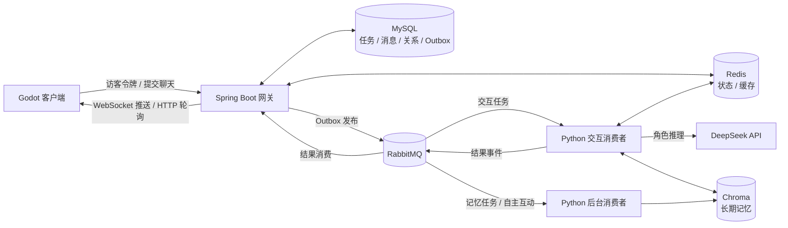

# 赛博小镇（Cyber Town 2.0）项目说明

> 基于当前仓库代码及截至 2026-11-03 的本地验收记录整理。本文描述已经实现的功能，并区分真实模型联调、Mock 测试和仍待验证的部分。

## 1. 项目定位

赛博小镇是一个大模型驱动的游戏 NPC 交互项目。玩家在 Godot 小镇中接近角色、打开对话界面，可以与单个 NPC 聊天，也可以邀请多位 NPC 参与同一场景。NPC 的回复结合角色画像、当前情绪、玩家关系和分层记忆生成。大模型推理通过消息队列异步执行，避免游戏客户端长时间等待一个 HTTP 请求。

这里的“多 Agent”指**多个具有独立人设、关系和记忆的 NPC Agent 在同一场景中按轮次接话**，由确定性的 Scene Orchestrator 汇总结果。默认一轮，每位角色发言一次；最多可配置两轮。角色能看到同场景此前成功的台词，但不会自主创建工具或无限制讨论。

## 2. 当前功能

| 功能 | 玩家或系统看到的效果 | 实现位置 |
| --- | --- | --- |
| 小镇交互 | 玩家移动、靠近 NPC 后打开对话界面；NPC 有巡逻和基于已收到状态的情绪视觉反馈 | `helloagents-ai-town/scenes/`、`scripts/player.gd`、`scripts/dialogue_ui.gd`、`scripts/npc.gd` |
| 单 NPC 对话 | 对指定 NPC 发消息，异步收到符合人设的回复及好感度变化 | Godot `api_client.gd` → Java `/api/chat` → Python `mq_consumer.py` |
| 多 NPC 场景 | 一次邀请 2～3 位不同 NPC，后发言角色看到此前台词，按轮次展示；某一角色失败时保留其他成功回复 | Java `/api/chat/scene`、Python `scene_orchestrator.py` |
| 访客身份 | 签发带有效期的访客令牌；聊天、结果查询和 WebSocket 使用该身份，结果按玩家隔离 | `GuestSessionController`、`PlayerIdentityService` |
| 情绪与关系 | NPC 状态影响回复语气；好感度按玩家和 NPC 分别记录，结果提交时原子更新 | `MoodSimulationService`、Redis 状态、MySQL `player_npc_relations` |
| 分层记忆 | Redis 保存近期对话；Chroma 按玩家和 NPC 检索长期语义记忆；长期记忆由后台任务筛选写入 | `langchain_agent.py`、`background_consumer.py` |
| 意图路由与工具 | 普通闲聊直接回复；身份、关系、记忆、天气等问题按路由进入代码规划和工具执行 | `langchain_agent.py` 中的 Router、Planner、Executor |
| 异步结果通知 | 提交后先得到任务 ID；WebSocket 定向推送结果，HTTP 轮询负责断线兜底 | `ChatWebSocketHandler`、`WebSocketPushService`、Godot `api_client.gd` |
| 后台 NPC 互动 | 定时选取 NPC 组合，受每日次数及冷却限制；默认关闭 | `NpcInteractionService`、`background_consumer.py` |

当前角色数据由 MySQL 提供，仓库初始化数据包含牧濑红莉栖、雪之下雪乃和仪玄。天气工具使用代码中的示例天气数据，**不是实时天气接口**。

## 3. 技术栈及职责

| 技术 | 在本项目中具体负责什么 |
| --- | --- |
| Godot 4.6、GDScript | 游戏场景、玩家移动、NPC 交互、对话 UI、HTTP 请求、WebSocket 接收与轮询兜底 |
| Java 17、Spring Boot 3.2 | 对外 API、访客身份校验、任务创建与状态管理、定时发布和补偿、结果入库、WebSocket 推送 |
| MyBatis-Plus、MySQL 8.4 | NPC 画像、会话消息、任务、玩家关系、请求去重键和事务性 Outbox 的持久化；MySQL 是这些业务数据的事实源 |
| RabbitMQ 3 | 交互任务、推理结果及后台任务的异步传递；重试队列、死信队列、发布确认和手动 ACK |
| Redis 7 | 短期对话记忆、NPC 实时状态、任务缓存、消费租约、后台记忆幂等标记与自主互动限额 |
| Python、Pika | 独立的交互消费者与后台消费者，消费 RabbitMQ 任务并发布结果 |
| LangChain、`langchain-openai` | 组织提示词、历史消息和模型调用；通过 OpenAI 兼容接口连接模型服务 |
| DeepSeek API | 当前默认的真实对话模型服务；模型配置和密钥保存在本机环境文件中 |
| Hugging Face Embeddings、Chroma | 将文本编码为向量并保存长期记忆，按玩家和 NPC 过滤、语义召回 |
| FastAPI | Python 侧保留的 `/agent/react`、`/agent/batch_react` 和 `/health` 接口；**当前游戏聊天主链路使用 RabbitMQ 消费者，并不经过 FastAPI** |
| Docker Compose | 在本地启动 MySQL、RabbitMQ 和 Redis |

## 4. 系统结构

主要目录：`helloagents-ai-town/` 是 Godot 客户端，`java-gateway/` 是业务网关，`backend/` 是 Python 推理与消费者，`docker/mysql-init/` 是数据库初始化及迁移脚本。

## 5. 一次聊天的完整流程

1. **获取身份**：Godot 调用 `POST /api/player/guest` 获取签名访客令牌。后续 HTTP 请求携带 `Authorization: Bearer <token>`；WebSocket 连接在 URL 查询参数中携带令牌。
2. **提交任务**：单聊调用 `POST /api/chat`，多 NPC 场景调用 `POST /api/chat/scene`。Java 校验身份、角色和请求内容，使用 `client_request_id` 识别重复提交。重复且内容一致的请求返回原任务，内容不同则拒绝。
3. **事务落库**：Java 在一个 MySQL 事务中写入玩家消息、聊天任务和待发布 Outbox 事件，然后立即返回 `task_id` 与任务状态。
4. **异步投递**：`OutboxPublisher` 扫描待发布事件，向 RabbitMQ 发送持久化消息，并依据 Publisher Confirm 更新发布状态。
5. **角色推理**：Python `mq_consumer.py` 获取任务，借助 Redis 租约避免同一任务并发推理，读取角色画像、关系、情绪和记忆，再调用模型。普通聊天可直接回复；需要背景信息时走 Router → Planner → 工具 → 回复生成。
6. **多 NPC 编排**：场景任务进入 `scene_orchestrator.py`，角色按请求顺序接话。每位角色保留独立人设和记忆，后发言者会收到此前成功台词的有限长度场景记录；轮数、角色超时、总超时和模型调用数都有上限。编排器校验角色身份、回复和好感度变更，为结果标注轮次与发言顺序。
7. **提交结果**：Python 将结果事件投回 RabbitMQ。Java 锁定任务记录、检查终态，在事务中写 NPC 台词、原子更新关系并置为完成或失败；重复结果不会重复产生业务副作用。成功对话还会产生后台记忆事件。
8. **通知玩家**：事务提交后，Java 按玩家身份定向推送 WebSocket 消息。Godot 同时可用 `GET /api/chat/result/{taskId}` 轮询；界面展示对应任务的台词、情绪和关系变化。
9. **整理记忆**：独立的 `background_consumer.py` 从后台队列接收记忆事件，筛选值得保留的事实、去重后写入 Chroma。记忆整理失败不撤销已经完成的聊天。

## 6. 可靠性与数据隔离

- **避免任务丢失**：任务与 Outbox 在同一 MySQL 事务中提交；发布到 RabbitMQ 使用 Publisher Confirm。交互任务按 5 秒、15 秒、45 秒分级重试，超过上限进入死信队列；Java 定时扫描停滞任务并补偿。
- **避免重复副作用**：客户端请求 ID 按玩家唯一；Python 侧有 Redis 消费租约及已完成推理缓存；Java 侧锁定任务并检查终态；关系更新使用 MySQL 原子增量。
- **隔离玩家数据**：访客令牌确定玩家 ID，结果查询检查任务归属；短期记忆键包含玩家、NPC 和会话，Chroma 检索同时过滤玩家与 NPC。
- **隔离不同负载**：实时对话、推理结果和后台记忆使用不同队列；后台消费者单独运行。WebSocket 推送由有界线程池执行，客户端可通过轮询补齐结果。
- **失败范围可控**：多 NPC 场景中单个角色失败可保留其他成功发言；全部失败时任务进入失败或重试流程。模型服务返回不可重试的 400/401/403/404/422 时，消费者给出明确失败信息。

## 7. 主要接口

| 接口 | 用途 |
| --- | --- |
| `POST /api/player/guest` | 创建访客身份 |
| `POST /api/chat` | 创建单 NPC 对话任务 |
| `POST /api/chat/scene` | 创建 2～3 位 NPC 的场景任务 |
| `GET /api/chat/result/{taskId}` | 查询任务状态与结果，供轮询兜底 |
| `GET /api/npcs` | 获取 MySQL 中的 NPC 列表、画像和当前情绪 |
| `GET /api/npcs/status` | 获取 NPC 状态文字与当前情绪，供 Godot 定时刷新 |
| `WS /ws/chat` | 按玩家推送任务结果 |

本地依赖默认由 Docker Compose 提供；具体安装、数据库迁移、环境变量和启动命令见 [SETUP_GUIDE.md](./SETUP_GUIDE.md)。

## 8. 已验证范围与当前限制

截至 2026-11-03，已有 Java 10 项、Python 30 项测试通过；Godot 客户端与界面的脚本测试通过。真实 DeepSeek API 已完成单 NPC、双 NPC 场景、多轮对话及后台记忆的小规模联调；新增按序接话版本也通过真实 Godot 双 NPC 场景测试。用户已在游戏窗口手动确认后发言 NPC 能接续前一位的台词。客户端脚本测试中强制断开 WebSocket，HTTP 轮询收到结果后 WebSocket 重新连接。50 位虚拟玩家的双 NPC 链路测试为**旧版并行生成流程的 Mock 角色模型**，50/50 任务完成、P95 为 8.14 秒；该数字不能当作新版按序接话流程或真实 DeepSeek 的吞吐与线上性能。

当前仍需注意：

- 访客令牌不是正式账号系统；没有账号找回、跨设备同步、令牌撤销、HTTPS/WSS 和入口限流，尚不宜直接作为公网正式服务。
- 后台 NPC 自主互动默认关闭，仅通过 Mock 链路验收；尚未用真实 DeepSeek 单独演练。
- Godot 的脚本端到端测试已通过，人工窗口点击和断线重连后的界面补齐尚未完整演练。
- 旧 MySQL 数据卷需先备份并执行 `docker/mysql-init/005_scene_turns.sql`，为多轮发言增加 `turn_no` 和唯一索引。默认一轮使用 2～3 次模型调用；两轮双 NPC 需将 Java 与 Python 的 `MAX_LLM_CALLS_PER_TASK` 同步提高到 4。
- 本机因多语言 embedding 模型缓存不完整，暂用 `all-MiniLM-L6-v2` 离线模型；中文语义检索质量可能受影响。
- 尚无真实模型并发压测、完整故障恢复演练和统一 Token 用量统计。同步外部模型调用超时后也不能保证取消已发出的计费请求。

更详细的升级验收记录见 [MULTI_AGENT_UPGRADE.md](./MULTI_AGENT_UPGRADE.md)，消息可靠性设计见 [RELIABLE_AGENT_BACKEND.md](./RELIABLE_AGENT_BACKEND.md)。
